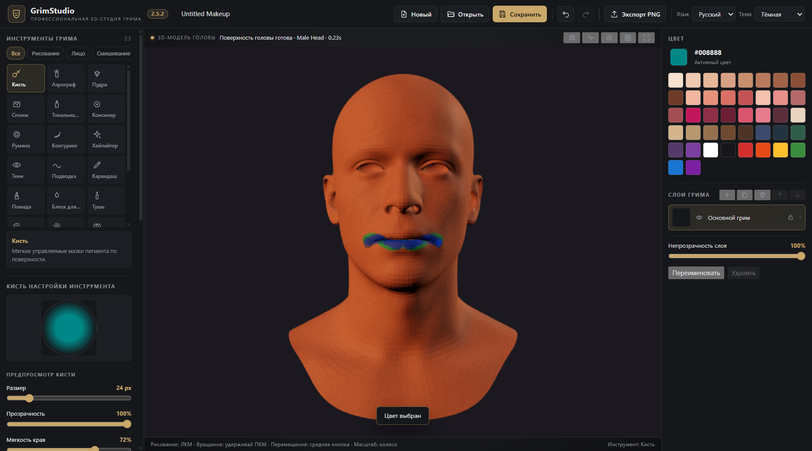

<div align="center">


# GrimStudio 2.5.2

**Professional 3D makeup & face-paint studio** · **Профессиональная 3D-студия грима**

[](https://github.com/LatovaRR/grimstudio/releases)
[](https://github.com/LatovaRR/grimstudio/releases)
[](https://www.electronjs.org/)
[](#license--лицензия)

**English** · [Русский](#-русский)



</div>

---

## ⬇ Download · Скачать

| File | Description |
|---|---|
| **[GrimStudio-2.5.2-x64.exe](https://github.com/LatovaRR/grimstudio/releases/download/v2.5.2/GrimStudio-2.5.2-x64.exe)** | Windows installer (NSIS) · Установщик |
| **[GrimStudio-2.5.2-portable.exe](https://github.com/LatovaRR/grimstudio/releases/download/v2.5.2/GrimStudio-2.5.2-portable.exe)** | Portable, no installation · Портативная версия |
| **[Source code (zip)](https://github.com/LatovaRR/grimstudio/archive/refs/tags/v2.5.2.zip)** | Source snapshot · Исходники |

> Requires Windows 10/11 x64. No Node.js or internet needed on the target machine.
> Требуется Windows 10/11 x64. Node.js и интернет на целевом компьютере не нужны.
> Note: the app is unsigned — Windows SmartScreen may ask to confirm the first launch («More info → Run anyway»).
> Примечание: приложение не подписано — SmartScreen может попросить подтвердить первый запуск («Подробнее → Выполнить в любом случае»).

---

## 🇬🇧 English

GrimStudio is a desktop 3D makeup and face-paint editor. Paint directly on a realistic 3D head with surface-attached decals that follow the lighting and curvature of the skin — the original model materials are never modified.

### Features

- **Surface-accurate painting** — every brush stroke is projected onto the 3D surface: it wraps around nose, lips and eye sockets, shaded exactly like the skin beneath (facial features stay visible under heavy paint).
- **23 makeup tools** — brush, airbrush, powder, sponge, foundation, concealer, blush, contour, highlighter, eyeshadow, eyeliner, pencil, lipstick, gloss, mascara, brows, blur, blender, eraser, stencil, stamp, symmetry, eyedropper.
- **Working blend tools** — Blur repaints the local averaged pigment; Blender mixes it with the active color; the Eyedropper samples the *composited* color where paint already mixed.
- **Continuous eraser** — press and drag to erase along the whole brush path (mirrored with symmetry), no flicker, no missed spots.
- **Lighting studio** — color temperature (1500–9500 K), light direction (azimuth/elevation), separate key/fill/rim/ambient intensity, ten real-life presets (studio portrait, vanity mirror, overcast, direct sun, golden hour, sunset, moonlight, backstage, candlelight, ring light) and a light-source indicator that shows exactly where the light comes from.
- **Brush preview** — a live 2D stamp preview in the panel plus an on-model cursor that shows the real brush footprint (and its mirror twin) while painting; 10 shape presets.
- **Layers** — up to 10 independent makeup layers with visibility, locking, opacity, thumbnails and per-layer undo history.
- **Lighting, accent and brush-shape settings persist** between sessions; projects save to `Documents\GrimStudio Projects`, exports to `Pictures\GrimStudio`.
- **Custom accent color** — 8 presets plus a custom picker for the interface theme.
- **Bilingual interface** — English / Russian, dark and light themes.

### Shortcuts

`B` brush · `E` eraser · `I` eyedropper · `M` symmetry · `G` grid · `L` new layer · `1–4` views · `[` `]` brush size · `+` `−` zoom · `Tab` hide panels · `Ctrl+Z / Ctrl+Shift+Z` undo/redo · `Ctrl+S` save · `Ctrl+E` export PNG

### Build from source

Requires Node.js 20+ (build machine only):

```bash
npm install
npm test
npm run dist        # → dist/GrimStudio-2.5.2-x64.exe + portable
```

Or simply run **`Build Windows Installer.bat`** on Windows.

### Project versions (git tags)

| Tag | Highlights |
|---|---|
| `v2.5.1` | Lighting studio, working blur/blender, eyedropper compositing, brush cursor, accent themes |
| `v2.5.2` | Smudge removed, flicker-free eraser rework, light-source gizmo, fine fill/rim/ambient light, new app icon |

Rollback: `git checkout v2.5.1`

---

## 🇷🇺 Русский

GrimStudio — настольный 3D-редактор грима и макияжа лица. Рисование идёт прямо по реалистичной 3D-голове: мазки прикрепляются к поверхности и наследуют её освещение и изгибы — исходные материалы модели никогда не изменяются.

### Возможности

- **Точное рисование по поверхности** — каждый мазок проецируется на 3D-модель: огибает нос, губы и глазницы и затеняется ровно как кожа под ним (черты лица остаются различимы под плотным гримом).
- **23 инструмента грима** — кисть, аэрограф, пудра, спонж, тональная основа, консилер, румяна, контуринг, хайлайтер, тени, подводка, карандаш, помада, блеск, тушь, брови, размытие, смешивание, ластик, трафарет, штамп, симметрия, пипетка.
- **Работающие инструменты смешивания** — «Размытие» перекрашивает участок усреднённым локальным пигментом, «Смешивание» добавляет к нему активный цвет, «Пипетка» берёт *уже смешанный* цвет в месте наложения мазков.
- **Непрерывный ластик** — зажми и веди: стирает вдоль всего пути кисти (с зеркальным режимом при симметрии), без мерцания и пропусков.
- **Студия освещения** — температура 1500–9500 K, направление света (азимут/высота), раздельная яркость ключевого/заполняющего/контрового/фонового света, десять пресетов из реальной жизни (студийный портрет, зеркало гримёрки, пасмурный день, прямое солнце, золотой час, закат, лунный свет, закулисные софиты, свет свечи, кольцевая лампа) и индикатор, точно показывающий, откуда светит свет.
- **Предпросмотр кисти** — живой предпоказ штампа в панели и курсор на модели с реальным следом кисти (и зеркальным двойником); 10 предустановок формы.
- **Слои** — до 10 независимых слоёв грима: видимость, блокировка, прозрачность, миниатюры, история отмены на слой.
- **Настройки сохраняются** между сессиями; проекты — в «Документы\GrimStudio Projects», экспорт PNG — в «Изображения\GrimStudio».
- **Свой акцентный цвет** интерфейса — 8 готовых пресетов и свой цвет.
- **Два языка интерфейса** — русский / English, тёмная и светлая темы.

### Сборка из исходников

Нужен Node.js 20+ (только на машине сборки):

```bash
npm install
npm test
npm run dist        # → dist/GrimStudio-2.5.2-x64.exe + портативная версия
```

Или просто запусти **`Build Windows Installer.bat`** на Windows.

### Версии проекта (git-теги)

| Тег | Что вошло |
|---|---|
| `v2.5.1` | Студия освещения, рабочие размытие/смешивание, композитная пипетка, курсор кисти, акцентные темы |
| `v2.5.2` | Удалён инструмент «Размазывание», ластик без мерцания, индикатор источника света, тонкая настройка fill/rim/ambient, новая иконка |

Откат: `git checkout v2.5.1`

---

## License · Лицензия

MIT — see [LICENSE](LICENSE).
