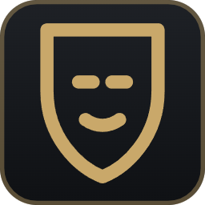
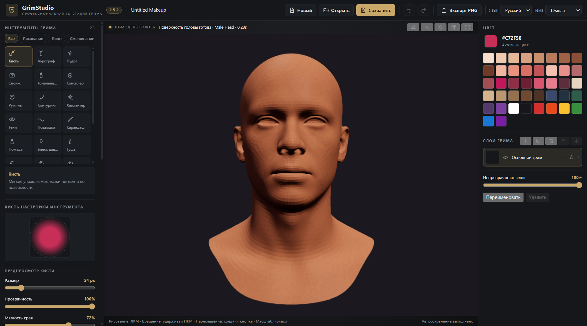
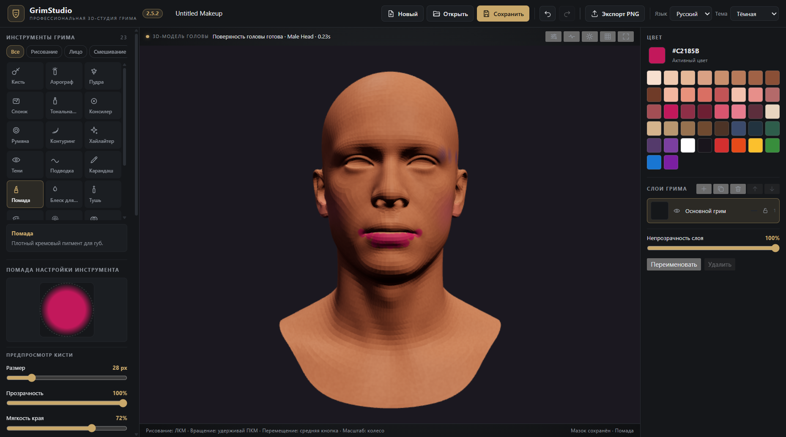
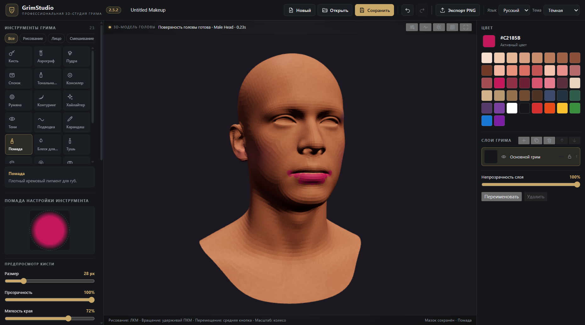
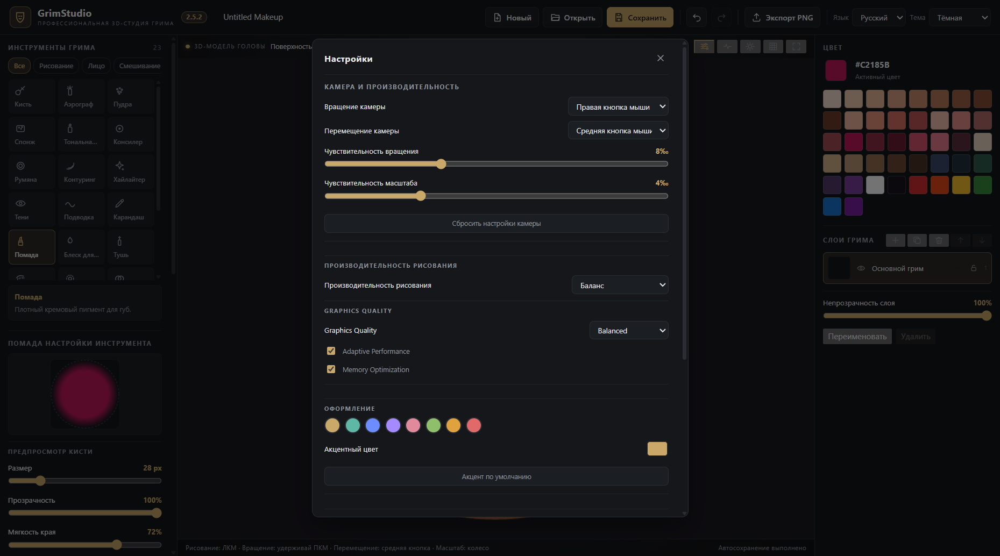

<div align="center">



# GrimStudio 2.5.2

**Professional 3D makeup & face-paint studio** · **Профессиональная 3D-студия грима**

[](https://github.com/LatovaRR/grimstudio/releases)
[](https://github.com/LatovaRR/grimstudio/releases)
[](https://www.electronjs.org/)
[](#license--лицензия)

**English** · [Русский](#-русский)

</div>

---

## ⬇ Download · Скачать

| File | Description |
|---|---|
| **[GrimStudio-2.5.2-x64.exe](https://github.com/LatovaRR/grimstudio/releases/download/v2.5.2/GrimStudio-2.5.2-x64.exe)** | Windows installer (NSIS) · Установщик |
| **[GrimStudio-2.5.2-portable.exe](https://github.com/LatovaRR/grimstudio/releases/download/v2.5.2/GrimStudio-2.5.2-portable.exe)** | Portable, no installation · Портативная версия |

> **Requires Windows 10/11 x64.** No Node.js or internet needed on the target machine.
> **Требуется Windows 10/11 x64.** Node.js и интернет на целевом компьютере не нужны.
>
> ⚠️ The app is not code-signed, so on the **first launch** Windows SmartScreen will show
> «Windows protected your PC» — click **More info → Run anyway**. This is expected for unsigned apps.
>
> ⚠️ Приложение не имеет цифровой подписи, поэтому при **первом запуске** Windows SmartScreen
> покажет «Система Windows защитила ваш компьютер» — нажмите **Подробнее → Выполнить в любом случае**.
> Это нормально для неподписанных приложений.

---

## 💎 Support · Поддержать проект

GrimStudio is free. If it is useful to you, you can support development with a TON donation.
GrimStudio бесплатен. Если приложение вам полезно, можно поддержать разработку донатом в TON.

<div align="center">


</div>

**Address · Адрес (TON network only · только сеть TON):**

```
UQC4yRjAxohUwu6qDN074EzPPvyC619nGBUM1YBzxksZBk5M
```

> ⚠️ **Send only TON (GRAM) and TON-network tokens to this address** (USDT works only as a jetton
> inside the TON network). Transfers from other networks — TRC-20, ERC-20, BEP-20 — **will be lost**.
>
> ⚠️ **На этот адрес отправляйте только TON (GRAM) и токены сети TON** (USDT доходит только
> как жетон внутри сети TON). Переводы из других сетей — TRC-20, ERC-20, BEP-20 — **будут потеряны**.
>
> Scan the QR with any TON wallet (Tonkeeper, Telegram Wallet, MyTonWallet), or verify the address
> on [tonviewer](https://tonviewer.com/UQC4yRjAxohUwu6qDN074EzPPvyC619nGBUM1YBzxksZBk5M).
>
> Отсканируйте QR любым TON-кошельком (Tonkeeper, Telegram Wallet, MyTonWallet) или проверьте
> адрес на [tonviewer](https://tonviewer.com/UQC4yRjAxohUwu6qDN074EzPPvyC619nGBUM1YBzxksZBk5M).

---

## 🇬🇧 English

GrimStudio is a desktop 3D makeup and face-paint studio. Paint directly on a realistic 3D head: every stroke is attached to the surface, follows its curvature and inherits its lighting — the original model materials are never modified.

### Screenshots

**Clean workspace** — the model is ready to paint:



**Painting on the model** — eyeshadow, blush and lipstick applied right on the 3D surface:



**The head can be rotated** — paint stays attached to the surface:



**Settings** — camera, performance, appearance and accent color:



### Features

- **Surface-accurate painting** — strokes wrap around nose, lips and eye sockets and are shaded exactly like the skin beneath, so facial features stay visible under heavy paint.
- **23 makeup tools** — brush, airbrush, powder, sponge, foundation, concealer, blush, contour, highlighter, eyeshadow, eyeliner, pencil, lipstick, gloss, mascara, brows, blur, blender, eraser, stencil, stamp, symmetry, eyedropper.
- **Working blend tools** — Blur repaints the area with the locally averaged pigment; Blender mixes it with the active color; the Eyedropper samples the *composited* color where paint has already mixed.
- **Continuous eraser** — press and drag to erase along the whole brush path (mirrored when symmetry is on), no flicker, no missed spots.
- **Lighting studio** — color temperature (1500–9500 K), light direction (azimuth/elevation), separate key/fill/rim/ambient intensity, ten real-life presets and a light-source indicator showing exactly where the light comes from.
- **Brush preview** — a live 2D stamp preview in the panel plus an on-model cursor showing the real brush footprint (and its mirror twin) while painting; 10 shape presets.
- **Layers** — up to 10 independent makeup layers with visibility, locking, opacity, thumbnails and per-layer undo history.
- **Settings persist** between sessions; projects are saved to `Documents\GrimStudio Projects`, PNG exports go to `Pictures\GrimStudio`.
- **Custom accent color** — 8 presets plus a custom picker for the interface theme.
- **Bilingual interface** — English / Russian, dark and light themes.

### Shortcuts

`B` brush · `E` eraser · `I` eyedropper · `M` symmetry · `G` grid · `L` new layer · `1–4` views · `[` `]` brush size · `+` `−` zoom · `Tab` hide panels · `Ctrl+Z / Ctrl+Shift+Z` undo/redo · `Ctrl+S` save · `Ctrl+E` export PNG

### Build from source

Requires Node.js 20+ on the build machine only:

```bash
npm install
npm test
npm run dist        # → dist/GrimStudio-2.5.2-x64.exe + portable
```

---

## 🇷🇺 Русский

GrimStudio — настольная 3D-студия грима и макияжа. Рисование идёт прямо по реалистичной 3D-голове: каждый мазок прикрепляется к поверхности, повторяет её изгибы и наследует её освещение — исходные материалы модели никогда не изменяются.

### Скриншоты

**Чистое рабочее пространство** — модель готова к рисованию:


**Рисование по модели** — тени, румяна и помада нанесены прямо на 3D-поверхность:


**Голову можно поворачивать** — грим остаётся прикреплённым к поверхности:


**Настройки** — камера, производительность, оформление и акцентный цвет:


### Возможности

- **Точное рисование по поверхности** — мазки огибают нос, губы и глазницы и затеняются ровно как кожа под ними, поэтому черты лица остаются различимы под плотным гримом.
- **23 инструмента грима** — кисть, аэрограф, пудра, спонж, тональная основа, консилер, румяна, контуринг, хайлайтер, тени, подводка, карандаш, помада, блеск, тушь, брови, размытие, смешивание, ластик, трафарет, штамп, симметрия, пипетка.
- **Работающие инструменты смешивания** — «Размытие» перекрашивает участок усреднённым локальным пигментом, «Смешивание» добавляет к нему активный цвет, «Пипетка» берёт *уже смешанный* цвет в месте наложения мазков.
- **Непрерывный ластик** — зажми и веди: стирает вдоль всего пути кисти (с зеркалом при симметрии), без мерцания и пропусков.
- **Студия освещения** — температура 1500–9500 K, направление света (азимут/высота), раздельная яркость ключевого/заполняющего/контрового/фонового света, десять пресетов из реальной жизни и индикатор, точно показывающий, откуда светит свет.
- **Предпросмотр кисти** — живой предпоказ штампа в панели и курсор на модели с реальным следом кисти (и зеркальным двойником); 10 предустановок формы.
- **Слои** — до 10 независимых слоёв грима: видимость, блокировка, прозрачность, миниатюры, история отмены на слой.
- **Настройки сохраняются** между сессиями; проекты — в «Документы\GrimStudio Projects», экспорт PNG — в «Изображения\GrimStudio».
- **Свой акцентный цвет** интерфейса — 8 готовых пресетов и свой цвет.
- **Два языка интерфейса** — русский / English, тёмная и светлая темы.

### Горячие клавиши

`B` кисть · `E` ластик · `I` пипетка · `M` симметрия · `G` сетка · `L` новый слой · `1–4` виды · `[` `]` размер кисти · `+` `−` масштаб · `Tab` скрыть панели · `Ctrl+Z / Ctrl+Shift+Z` отмена/повтор · `Ctrl+S` сохранить · `Ctrl+E` экспорт PNG

### Сборка из исходников

Нужен Node.js 20+ — только на машине сборки:

```bash
npm install
npm test
npm run dist        # → dist/GrimStudio-2.5.2-x64.exe + портативная версия
```

---

## License · Лицензия

MIT — see [LICENSE](LICENSE).
